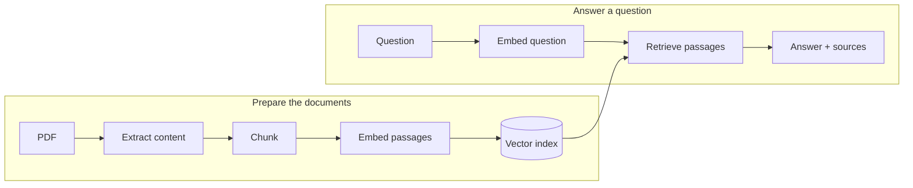

# From PDFs to answers you can check

How do you turn a PDF into an answer that someone can check against the source?

This .NET AI Community Standup demo walks through the pieces: reading a
document, preparing searchable passages, retrieving relevant context, and
giving that context to a chat model. Start with small .NET 10 file-based apps,
then see them come together in a Chat-template application.

**You can try extraction, chunking, and the slides without Azure credentials
or paid AI calls.**

## What you'll learn

The demo follows two workflows, connected by a vector index:



Documents are prepared before questions arrive; the app doesn't extract the
PDF again for every question. The walkthrough compares a PDF with embedded
text and a scanned copy of the same pages, showing where a local reader is
enough and where an OCR-capable provider makes a difference.

| Start here | What it shows |
|---|---|
| [01: Extract](samples/01-extract.cs) | Read a PDF and inspect its content and source pages. Compare local PdfPig extraction with Azure Content Understanding. |
| [02: Ingest](samples/02-ingest.cs) | Use Microsoft.Extensions.DataIngestion to split content into token-sized chunks while keeping its source association. |
| [03: Retrieve](samples/03-retrieve.cs) | Generate embeddings through Microsoft.Extensions.AI and search a SQLite vector index through VectorData. Requires live Azure configuration. |
| [Chat-template app](hero) | Put preparation, retrieval, chat, and source inspection together in a web UI. |

> **Prototype APIs:** The Documents and document extraction APIs used here are
> pinned, unofficial API-review prototypes, not released APIs. The required
> source is included so you can build the demo locally.
> See [prototype status and provenance](vendor/NOTICE.md).

## Get started

The sample instructions are **Windows/PowerShell-first**. You'll need:

- **.NET SDK 10.0.403** for the C# samples and web app.
- **Node.js** for the slides only; tested with **24.22.1**.

Clone the repository:

```powershell
git clone https://github.com/luisquintanilla/data-ingestion-standup-demo.git
Set-Location .\data-ingestion-standup-demo
```

### Run extraction and chunking locally

From the repository root:

```powershell
$env:STANDUP_PROVIDER = 'pdfpig'
Remove-Item Env:\STANDUP_LIVE -ErrorAction SilentlyContinue
Remove-Item Env:\STANDUP_BUDGET_PATH -ErrorAction SilentlyContinue

.\scripts\prepare.ps1
dotnet run --file samples\01-extract.cs -- digital
dotnet run --file samples\02-ingest.cs -- digital
```

Preparation downloads public NuGet dependencies and builds the pinned
prototype packages. The two samples then process the bundled PDF locally:
**2 pages, 2 extracted content elements, and 12 chunks**.

Now try the scanned copy:

```powershell
dotnet run --file samples\01-extract.cs -- scanned
dotnet run --file samples\02-ingest.cs -- scanned
```

You'll see **2 pages but no extracted text or chunks**. That's the point of
the comparison: PdfPig reads embedded text; it doesn't perform OCR or
automatically send the document to a cloud service.

### Explore the slides

You can preview the slides independently of the .NET setup:

```powershell
npm ci --ignore-scripts
$env:PORT = '8187'
npm run preview
```

Open [localhost:8187](http://127.0.0.1:8187). The 42-slide deck includes code,
recorded outputs, speaker notes, and workflow markers that show where each
step fits. Use the arrow keys to advance and **S** to open speaker notes.

### Run the web app or connect Azure

Follow the [web app instructions](RUNBOOK.md#chat-template-payoff) to launch
the Chat-template UI and inspect documents locally.

Content Understanding, embeddings, and chat require your own Azure resources
and explicit live configuration. These steps can incur costs and are
**disabled by default**. A clone includes no credentials, live endpoints,
ready indexes, or authorized budget file. See
[live configuration](RUNBOOK.md#live-configuration-is-deliberately-not-armed)
before running sample 03 or building an index in the web app.

## Explore the repository

| Location | What's inside |
|---|---|
| [samples](samples) | The three standalone C# file apps. |
| [src/Standup.Core](src/Standup.Core) | Extraction adapters and the shared ingestion, indexing, and model-client code. |
| [hero](hero) | The composed Chat-template app and Aspire apphost. |
| [slides.md](slides.md) | The editable presentation and speaker notes. |
| [RUNBOOK.md](RUNBOOK.md) | Full setup, commands, configuration, troubleshooting, and demo details. |
| [Recorded results](evidence/public/README.md) | Actual native/CU outputs, screenshots, and their limitations. |

The recorded live run completed extraction, embeddings, retrieval, and chat
with both providers. Those recordings are examples, not outputs generated
when you clone the repo. They also show why checking the source matters:
a correct number alone doesn't establish that the model understood a table.

## Questions and feedback

Maintained by [@luisquintanilla](https://github.com/luisquintanilla) for the
.NET AI Community Standup. If a step is unclear or a sample doesn't work,
[open an issue](https://github.com/luisquintanilla/data-ingestion-standup-demo/issues).

## License

The demo's original code is [MIT licensed](LICENSE). See
[third-party notices](THIRD-PARTY-NOTICES.md) for the licenses and attribution
of the bundled source, viewers, fonts, and document fixtures.
